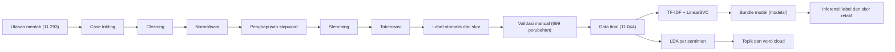

# Analisis Sentimen dan Pemodelan Topik pada Ulasan Aplikasi Qara'a


[](LICENSE)

Pipeline NLP untuk ulasan pengguna berbahasa Indonesia pada aplikasi belajar Al-Qur'an Qara'a. Proyek ini menggabungkan **Support Vector Machine (SVM)** untuk klasifikasi sentimen tiga kelas (positif, netral, negatif) dengan **Latent Dirichlet Allocation (LDA)** untuk menemukan topik di dalam ulasan positif dan negatif secara terpisah.

Awalnya dikembangkan sebagai skripsi sarjana. Repositori ini sedang direfaktor dan dirawat agar kode lebih jelas, hasil dapat direproduksi, dan evaluasi model lebih terukur.

---

## Tech Stack

| Komponen                | Library                                          | Fungsi                      |
| :---------------------- | :----------------------------------------------- | :-------------------------- |
| Bahasa                  | Python 3.11                                      | Runtime                     |
| Pengolahan data         | pandas, NumPy                                    | Pemrosesan tabel            |
| Stemming teks           | Sastrawi                                         | Stemmer bahasa Indonesia    |
| Klasifikasi             | scikit-learn (`LinearSVC`, `TfidfVectorizer`)    | Model sentimen              |
| Ketidakseimbangan kelas | imbalanced-learn (SMOTE)                         | Skema oversampling          |
| Pemodelan topik         | gensim (`LdaModel`, `Phrases`, `CoherenceModel`) | LDA dan koherensi c_v       |
| Visualisasi             | matplotlib, wordcloud                            | Grafik dan word cloud topik |
| Penyimpanan model       | joblib                                           | Menyimpan bundle inferensi  |

Versi library yang dikunci tercantum di `requirements.txt` dan `environment.yml`.

---

## Sorotan

- Label awal berasal dari rating bintang, lalu kasus yang ditandai diperiksa manual, sehingga label final mencerminkan isi teks, bukan skor saja.
- Klasifikasi dievaluasi dengan **pembagian berbasis grup**, sehingga teks ulasan yang sama tidak pernah muncul di data latih dan data uji sekaligus. Ini penting karena banyak ulasan terduplikasi (misalnya "bagus" muncul ratusan kali).
- Ketidakseimbangan kelas ditangani dengan membandingkan tiga skema: tanpa penanganan, pembobotan kelas, dan SMOTE. Skema dipilih lewat validasi silang, bukan dari data uji.
- Pemodelan topik dijalankan terpisah per sentimen, dan jumlah topik dipilih berdasarkan koherensi c_v rata-rata dari sepuluh seed acak.

---

## Arsitektur dan Pipeline



Fungsi preprocessing yang sama (`preprocess_teks`) dipakai untuk data latih dan inferensi, sehingga keduanya mengikuti urutan langkah yang identik.

---

## Fitur

- Preprocessing dengan normalisasi variasi penulisan Al-Qur'an, penggabungan frasa religius, dan kamus slang bahasa Indonesia
- Penghapusan stopword yang sadar negasi, dengan tetap mempertahankan kata seperti _tidak_, _bukan_, _belum_, _sangat_, dan _tapi_
- Pelabelan otomatis dengan antrean ulasan untuk validasi manual berbasis aturan
- SVM dengan tiga skema ketidakseimbangan, dibandingkan pada pembagian berbasis grup
- LDA per sentimen dengan bigram dan koherensi rata-rata dari beberapa seed
- Inferensi yang mengembalikan label, skor relatif per kelas, dan skor keputusan mentah

---

## Data

| Item                                       | Nilai                                      |
| :----------------------------------------- | :----------------------------------------- |
| Sumber                                     | Ulasan Google Play Store, locale Indonesia |
| Periode                                    | 1 Januari 2020 sampai 15 November 2025     |
| Ulasan mentah                              | 11.293                                     |
| Ulasan final setelah cleaning dan validasi | 11.044                                     |
| Positif                                    | 9.742 (88,2%)                              |
| Negatif                                    | 1.020 (9,2%)                               |
| Netral                                     | 282 (2,6%)                                 |

Data ulasan mentah tidak dibagikan ulang di repositori ini. Fungsi scraping disimpan sebagai referensi dan nonaktif secara default, karena mengambil ulang data dapat mengubah isi dan merusak keselarasan baris yang dipakai validasi manual.

### Pelabelan

1. **Otomatis:** skor 1 dan 2 negatif, skor 3 netral, skor 4 dan 5 positif.
2. **Penandaan kandidat:** ulasan masuk antrean validasi manual jika netral berdasarkan skor, sentimennya bertentangan dengan kata kunci, menyebut fitur premium atau langganan padahal negatif, atau sangat pendek.
3. **Validasi manual:** 699 label diubah setelah ditinjau. Ulasan yang mengandung "oke" atau "lumayan" diperlakukan sebagai netral berdasarkan aturan, sehingga kelas netral sebagian besar berbasis aturan. Lihat Limitasi.

---

## Hasil

### Klasifikasi sentimen

Data uji: 2.178 ulasan, dengan pembagian berbasis grup dan tanpa tumpang tindih teks dengan data latih.

| Skema                |  Macro F1 CV (C)  | Macro F1 uji | F1 negatif uji | Recall negatif uji | Akurasi uji |
| :------------------- | :---------------: | :----------: | :------------: | :----------------: | :---------: |
| Tanpa penanganan     |   0,645 (C=1,0)   |    0,551     |     0,624      |       0,554        |    0,927    |
| **Pembobotan kelas** | **0,680 (C=0,5)** |  **0,686**   |   **0,686**    |     **0,701**      |  **0,931**  |
| SMOTE                |  0,622 (C=0,01)   |    0,665     |     0,596      |       0,902        |    0,880    |

Selisih F1 negatif dengan interval kepercayaan 95% dari bootstrap (1.000 resample):

- Pembobotan kelas vs tanpa penanganan: +0,062 [0,022; 0,105]
- Pembobotan kelas vs SMOTE: +0,090 [0,039; 0,140]

Pembobotan kelas dipilih karena memberi macro F1 CV terbaik dan F1 negatif uji terbaik. Pilihan ini juga sejalan dengan tujuan proyek, yaitu menangkap keluhan yang termasuk kelas negatif.

Hasil per kelas untuk model terpilih pada data uji:

| Kelas   | Precision | Recall |  F1   | Jumlah |
| :------ | :-------: | :----: | :---: | :----: |
| Positif |   0,962   | 0,964  | 0,963 | 1.948  |
| Negatif |   0,671   | 0,701  | 0,686 |  204   |
| Netral  |   0,615   | 0,308  | 0,410 |   26   |

### Pemodelan topik

| Sentimen | k terpilih | c_v (rata-rata ± std dari 10 seed) |
| :------- | :--------: | :--------------------------------: |
| Positif  |     2      |           0,491 ± 0,048            |
| Negatif  |     2      |           0,385 ± 0,020            |

Topik ditafsirkan dari kata teratas dan contoh ulasan. Topik positif memisahkan tema bantuan belajar dan belajar Al-Qur'an dari manfaat umum serta penyebutan langganan atau akses. Topik negatif memisahkan keluhan langganan dan pembayaran dari keluhan akses, performa, dan iklan.

Nilai koherensi untuk sentimen negatif rendah, sehingga kata-kata topik perlu dibaca bersama contoh ulasan, tidak berdiri sendiri.

---

## Memulai

### Prasyarat

- Python 3.11
- conda (miniconda atau anaconda)

### Instalasi

```bash
conda env create -f environment.yml
conda activate proyek-qaraa
```

Notebook dijalankan dari root proyek, sehingga path relatif terbaca dengan benar.

### Menggunakan model terlatih

```python
from src.inference import muat_model, prediksi

bundle = muat_model()
print(prediksi("aplikasinya bagus sekali, membantu saya belajar mengaji", bundle))
```

Keluaran berisi label prediksi, skor relatif untuk setiap kelas, dan skor keputusan mentah.

### Mereproduksi analisis

1. Pastikan `data/raw/` berisi file ulasan mentah. Notebook tidak melakukan scraping secara default.
2. Buka `ulasan-qaraa.ipynb` dan jalankan section secara berurutan: setup, scraping (hanya memuat), preprocessing, pelabelan, visualisasi, LDA, dan SVM.
3. Preprocessing dan pelabelan berjalan di memori secara default. Ubah `TULIS_INTERIM` atau `TULIS_LABEL` menjadi `True` hanya jika memang ingin membuat ulang file. Membuat ulang file mengubah keselarasan baris, sehingga validasi manual harus diulang setelahnya.

---

## Limitasi

- **Kelas netral kecil dan berbasis aturan.** Hanya ada 26 ulasan netral di data uji, dan sebagian besar label netral di data latih berasal dari aturan "oke" dan "lumayan". Hasil netral sebaiknya dianggap sebagai indikasi saja.
- **Teks duplikat sering muncul.** Evaluasi berbasis grup mencegah kebocoran, tetapi varians validasi silang tinggi (simpangan baku sekitar 0,09) karena beberapa teks yang sangat sering muncul mendominasi sebagian lipatan.
- **Keyakinan model belum terkalibrasi.** Inferensi melaporkan softmax dari skor keputusan sebagai skor relatif, bukan probabilitas.
- **Topik positif kurang tegas.** Selisih koherensi antar nilai k berada dalam variasi seed, sehingga k=2 dipilih berdasarkan aturan, bukan puncak yang jelas.
- **Aturan preprocessing spesifik proyek.** Kamus slang dan kamus koreksi mencerminkan data ini dan mungkin tidak berlaku untuk aplikasi lain.
- **Stemming bergantung versi library.** Keluaran Sastrawi dapat berubah antarversi, sehingga versi yang dikunci penting untuk reproduksi.

---

## Lisensi

Proyek ini dilisensikan sesuai ketentuan dalam berkas [LICENSE](LICENSE).
