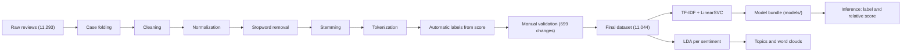

# Sentiment Analysis and Topic Modeling on Qara'a App Reviews


[](LICENSE)

An NLP pipeline for Indonesian user reviews of the Qara'a Quran learning application. It combines a **Support Vector Machine (SVM)** for three-class sentiment classification (positive, neutral, negative) with **Latent Dirichlet Allocation (LDA)** for discovering topics within positive and negative reviews separately.

Originally developed as an undergraduate thesis project. The repository is being refactored and maintained for code clarity, reproducibility, and model evaluation.

---

## Tech Stack

| Component       | Library                                          | Purpose                     |
| :-------------- | :----------------------------------------------- | :-------------------------- |
| Language        | Python 3.11                                      | Runtime                     |
| Data handling   | pandas, NumPy                                    | Tabular processing          |
| Text stemming   | Sastrawi                                         | Indonesian stemmer          |
| Classification  | scikit-learn (`LinearSVC`, `TfidfVectorizer`)    | Sentiment model             |
| Class imbalance | imbalanced-learn (SMOTE)                         | Oversampling scheme         |
| Topic modeling  | gensim (`LdaModel`, `Phrases`, `CoherenceModel`) | LDA and c_v coherence       |
| Visualization   | matplotlib, wordcloud                            | Plots and topic word clouds |
| Model storage   | joblib                                           | Saving the inference bundle |

Pinned versions are listed in `requirements.txt` and `environment.yml`.

---

## Highlights

- Labels start from star ratings, then flagged cases are reviewed manually, so final labels reflect review text rather than the score alone.
- The classifier is evaluated on a **group-aware split**, so the same review text never appears in both training and test data. This matters because many reviews are duplicated (for example, "bagus" appears hundreds of times).
- Class imbalance is handled by comparing three schemes: no handling, class weighting, and SMOTE. The scheme is selected by cross-validation, not by the test set.
- Topic modeling runs separately per sentiment, and the number of topics is selected by c_v coherence over ten random seeds.

---

## Architecture and Pipeline



The same preprocessing function (`preprocess_teks`) is used for the training data and for inference, so both follow an identical sequence of steps.

---

## Features

- Preprocessing with Qur'an spelling normalization, religious phrase merging, and a colloquial Indonesian lexicon
- Negation-aware stopword removal, keeping words such as _tidak_, _bukan_, _belum_, _sangat_, and _tapi_
- Automatic labeling with a rule-based review queue for manual validation
- SVM with three imbalance schemes, compared on a group-aware split
- LDA per sentiment with bigrams and seed-averaged coherence
- Inference that returns a label, relative scores, and raw decision scores

---

## Data

| Item                                        | Value                                        |
| :------------------------------------------ | :------------------------------------------- |
| Source                                      | Google Play Store reviews, Indonesian locale |
| Period                                      | 2020-01-01 to 2025-11-15                     |
| Raw reviews                                 | 11,293                                       |
| Final reviews after cleaning and validation | 11,044                                       |
| Positive                                    | 9,742 (88.2%)                                |
| Negative                                    | 1,020 (9.2%)                                 |
| Neutral                                     | 282 (2.6%)                                   |

Raw review data is not redistributed in this repository. The scraping function is kept for reference and is disabled by default, because re-scraping can change the data and break the row alignment used by manual validation.

### Labeling

1. **Automatic:** score 1 and 2 are negative, score 3 is neutral, score 4 and 5 are positive.
2. **Candidate flagging:** reviews are queued for manual review when they are neutral by score, when a sentiment conflicts with keywords, when they mention premium or subscription features while negative, or when they are very short.
3. **Manual validation:** 699 labels were changed after review. Reviews containing "oke" or "lumayan" were treated as neutral by rule, so the neutral class is largely rule-based. See Limitations.

---

## Results

### Sentiment classification

Test set: 2,178 reviews, grouped split with zero text overlap with training data.

| Scheme           |  CV macro F1 (C)  | Test macro F1 | Test negative F1 | Test negative recall | Test accuracy |
| :--------------- | :---------------: | :-----------: | :--------------: | :------------------: | :-----------: |
| No handling      |   0.645 (C=1.0)   |     0.551     |      0.624       |        0.554         |     0.927     |
| **Class weight** | **0.680 (C=0.5)** |   **0.686**   |    **0.686**     |      **0.701**       |   **0.931**   |
| SMOTE            |  0.622 (C=0.01)   |     0.665     |      0.596       |        0.902         |     0.880     |

Negative F1 difference with 95% bootstrap intervals (1,000 resamples):

- Class weight vs no handling: +0.062 [0.022, 0.105]
- Class weight vs SMOTE: +0.090 [0.039, 0.140]

Class weighting is selected because it gives the best CV macro F1 and the best negative F1 on the test set. The choice also matches the project goal of catching complaints, which belong to the negative class.

Per-class results for the selected model on the test set:

| Class    | Precision | Recall |  F1   | Support |
| :------- | :-------: | :----: | :---: | :-----: |
| Positive |   0.962   | 0.964  | 0.963 |  1,948  |
| Negative |   0.671   | 0.701  | 0.686 |   204   |
| Neutral  |   0.615   | 0.308  | 0.410 |   26    |

### Topic modeling

| Sentiment | Selected k | c_v (mean ± std over 10 seeds) |
| :-------- | :--------: | :----------------------------: |
| Positive  |     2      |         0.491 ± 0.048          |
| Negative  |     2      |         0.385 ± 0.020          |

Topics are interpreted from top words and sampled reviews. The positive topics separate learning-aid and Qur'an-learning themes from general benefits and subscription or access mentions. The negative topics separate subscription and payment complaints from access, performance, and advertisement complaints.

Coherence values for the negative sentiment are low, so topic words should be read together with example reviews rather than in isolation.

---

## Getting Started

### Prerequisites

- Python 3.11
- conda (miniconda or anaconda)

### Installation

```bash
conda env create -f environment.yml
conda activate proyek-qaraa
```

The notebook is run from the project root, so relative paths resolve correctly.

### Using the trained model

```python
from src.inference import muat_model, prediksi

bundle = muat_model()
print(prediksi("aplikasinya bagus sekali, membantu saya belajar mengaji", bundle))
```

The output includes the predicted label, a relative score for each class, and the raw decision scores.

### Reproducing the analysis

1. Make sure `data/raw/` contains the raw review file. The notebook does not scrape by default.
2. Open `ulasan-qaraa.ipynb` and run the sections in order: setup, scraping (load only), preprocessing, labeling, visualization, LDA, and SVM.
3. Preprocessing and labeling run in memory by default. Set `TULIS_INTERIM` or `TULIS_LABEL` to `True` only when intentionally regenerating files. Regenerating files changes row alignment, so manual validation must be redone afterward.

---

## Limitations

- **Neutral class is small and rule-driven.** There are only 26 neutral reviews in the test set, and most neutral training labels come from the "oke" and "lumayan" rule. Neutral results should be treated as indicative only.
- **Duplicate text is common.** Group-aware evaluation prevents leakage, but cross-validation variance is high (about 0.09 standard deviation) because a few very frequent review texts dominate some folds.
- **Model confidence is not calibrated.** Inference reports a softmax over decision scores as a relative score, not a probability.
- **Positive topics are less distinct.** Coherence differences between k values are within seed variance, so k=2 is selected by rule rather than by a clear peak.
- **Preprocessing rules are project-specific.** The slang lexicon and correction dictionaries reflect this dataset and may not generalize to other applications.
- **Stemming depends on the library version.** Sastrawi output can change between versions, so the pinned version matters for reproducibility.

---

## License

This project is licensed under the terms in the [LICENSE](LICENSE) file.
